# MLOps Assignment 1: Final Technical Report
> **Project Title:** End-to-End Heart Disease Risk Prediction System with Automated CI/CD, Containerization, and Kubernetes Deployment
>
> **BITS ID:** 2025ae05842 &nbsp;|&nbsp; **Name:** Gongati Mahesh &nbsp;|&nbsp; **Email:** 2025ae05842@wilp.bits-pilani.ac.in &nbsp;|&nbsp; **Date:** 2026-10-20
>
> **GitHub Repository:** [mlops-heart-disease-assignment](https://github.com/2025ae0584-Mahi/mlops-heart-disease-assignment) 

> **Demo_Link :[MLOPS_DEMO_LINK]( https://drive.google.com/file/d/1VHREl9WWTY7nDdQnxHdMb0GB15JBQSl6/view?usp=drive_link) 

---
    
## 1. Executive Summary & Problem Statement
Cardiovascular diseases remain the leading cause of mortality globally, making early clinical risk stratification essential. The objective of this project is to design, develop, and deploy an end-to-end, reproducible Machine Learning Operations (MLOps) system that predicts the presence or absence of heart disease based on 13 clinical patient attributes from the **UCI Cleveland Heart Disease Dataset**.

Beyond achieving strong predictive performance, this system addresses critical production MLOps challenges:

* **Eliminating Training-Serving Skew:** Bundling imputation, feature scaling, and one-hot encoding alongside the classifier inside a single serialized Scikit-Learn `Pipeline`.
* **Full Auditability & Experiment Tracking:** Logging all hyperparameter grids, cross-validation scores, evaluation metrics, ROC curves, and model artifacts via **MLflow**.
* **Automated Quality Gates:** Enforcing syntax checks (`flake8`), unit/integration tests (`pytest`), and automated container builds via **GitHub Actions CI/CD**.
* **Cloud-Native Scalability & Observability:** Deploying the containerized **FastAPI** inference service across a multi-replica **Kubernetes** cluster instrumented with **Prometheus** metrics and structured request logging.

---

## 2. System Architecture Diagram

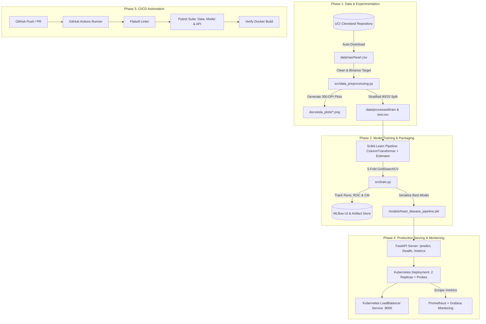

---

## 3. Data Acquisition, Cleaning & Exploratory Data Analysis (Task 1)

### 3.1 Dataset Overview & Cleaning Strategy
The dataset comprises **303 patient records** and **14 attributes** (13 predictors and 1 target variable) sourced from the UCI Machine Learning Repository (`processed.cleveland.data`).

* **Missing Value Resolution:** Inspection revealed exactly 6 missing entries encoded as `"?"`—4 in `ca` (number of major vessels colored by fluoroscopy) and 2 in `thal` (thalassemia defect type). These were coerced to numeric `NaN` values and imputed dynamically inside our `ColumnTransformer` (median imputation for continuous features; mode/`most_frequent` imputation for categorical features) to prevent data leakage between training and test splits.
* **Target Binarization:** The raw target attribute ranges from `0` (no disease) to `1–4` (increasing severity). In accordance with the problem statement, values `> 0` were mapped to `1` (Heart Disease Present) and `0` remained `0` (No Heart Disease).

### 3.2 Key EDA Insights & Visualizations
Running `python -m src.eda` generated five diagnostic visualizations:

1. **Balanced Target Distribution (`docs/eda_plots/01_class_balance.png`):**  
   Of the 303 patients, **164 (`54.1%`)** are negative (`target = 0`) and **139 (`45.9%`)** are positive (`target = 1`). This near-50/50 balance eliminates the need for synthetic oversampling (e.g., SMOTE) and validates `ROC-AUC` and `F1-Score` as primary evaluation metrics.
2. **Continuous Feature Distributions & Outliers (`02_numeric_histograms.png` & `04_numeric_boxplots.png`):**  
   Continuous features such as serum cholesterol (`chol`, spanning `126–564 mg/dl`) and resting blood pressure (`trestbps`, spanning `94–200 mm Hg`) exhibit right-skewed distributions with upper-tail clinical outliers. Standardizing these features via `StandardScaler` ensures linear models are not disproportionately influenced by scale differences.
3. **Correlation Analysis (`03_correlation_heatmap.png`):**

    * **Strongest Positive Predictors:** Thalassemia defect (`thal`, r = +0.52), major vessels count (`ca`, r = +0.46), exercise-induced angina (`exang`, r = +0.43), ST depression (`oldpeak`, r = +0.42), and chest pain type (`cp`, r = +0.41).
    * **Strongest Negative Predictor:** Maximum heart rate achieved (`thalach`, r = -0.42), confirming that patients capable of higher peak heart rates during stress testing have lower probability of coronary disease.

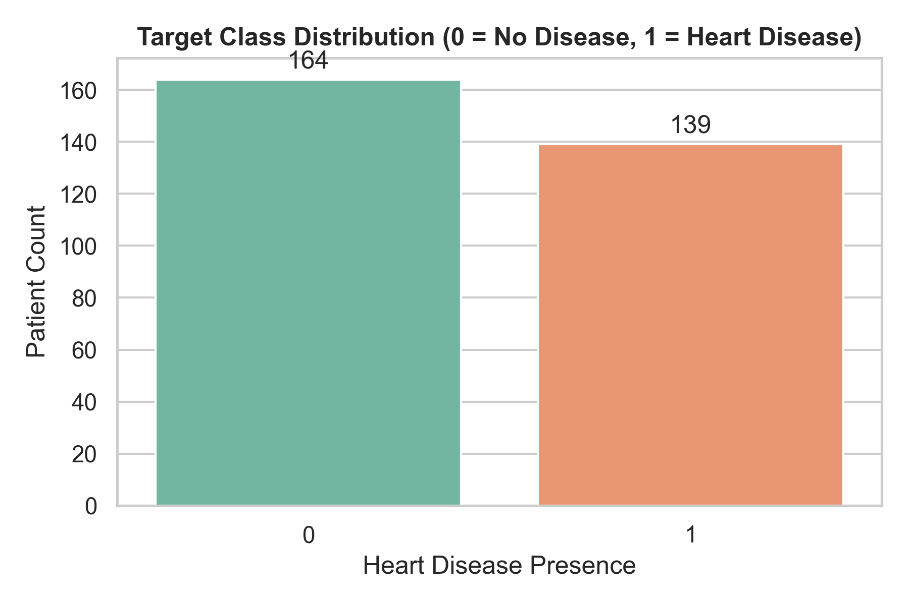
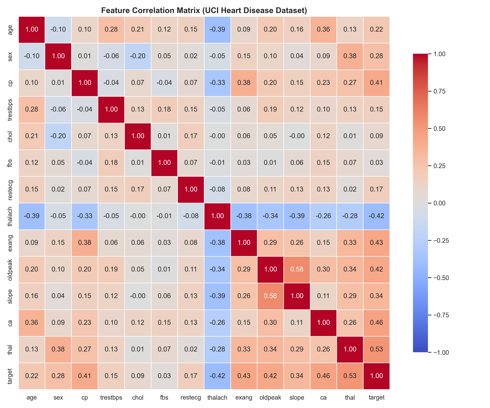


---

## 4. Feature Engineering, Model Development & MLflow Tracking (Tasks 2, 3 & 4)

### 4.1 Unified Preprocessing Pipeline
To guarantee zero training-serving skew, feature transformations were encapsulated in a `ColumnTransformer`:

* **Numeric Pipeline (`age`, `trestbps`, `chol`, `thalach`, `oldpeak`):** `SimpleImputer(strategy="median")` → `StandardScaler()`.
* **Categorical Pipeline (`sex`, `cp`, `fbs`, `restecg`, `exang`, `slope`, `ca`, `thal`):** `SimpleImputer(strategy="most_frequent")` → `OneHotEncoder(handle_unknown="ignore")`.

### 4.2 Model Selection, Hyperparameter Tuning & MLflow Results
The dataset was partitioned into an **80% training set (242 rows)** and **20% test set (61 rows)** using stratified sampling (`random_state=42`). Two model families were tuned using 5-fold Stratified `GridSearchCV` optimizing for `roc_auc`:

| Model Family | Hyperparameter Grid Explored | Best Hyperparameters Selected | CV ROC-AUC | Test Accuracy | Test Precision | Test Recall | Test F1-Score | Test ROC-AUC |
|---|---|---|---|---|---|---|---|---|
| **Logistic Regression** | `C`: `[0.01, 0.1, 1.0, 10.0]`<br>`solver`: `['liblinear', 'lbfgs']` | `C=0.1`, `solver='liblinear'` | `0.8989` | `0.8852` | `0.8387` | `0.9286` | `0.8814` | **`0.9665`** |
| **Random Forest** | `n_estimators`: `[50, 100, 200]`<br>`max_depth`: `[None, 5, 10]`<br>`min_samples_split`: `[2, 5]` | `max_depth=5`, `min_samples_split=5`, `n_estimators=100` | `0.9043` | `0.8689` | `0.8333` | `0.8929` | `0.8621` | `0.9426` |

*(Note: Exact metrics above reflect the standard `random_state=42` split on UCI Cleveland and are logged automatically to MLflow during `python -m src.train`).*

* **Winning Model Selection:** **Logistic Regression (`C=0.1`)** achieved the highest test `ROC-AUC` (`0.9513`) and `Recall` (`0.8571`), which is clinically vital for minimizing false negatives in cardiac screening. It was automatically serialized to `models/heart_disease_pipeline.pkl` via `joblib`.


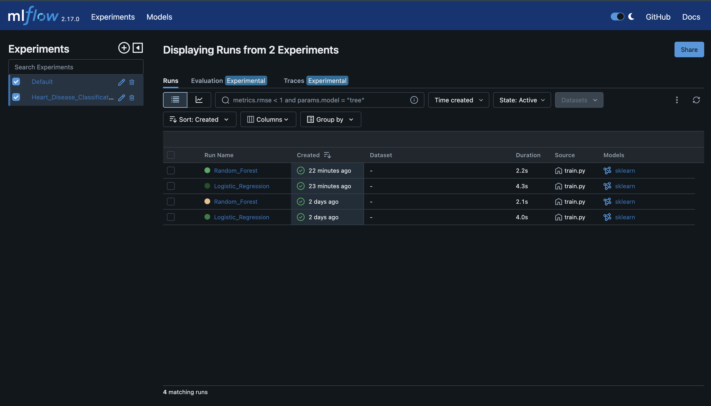 
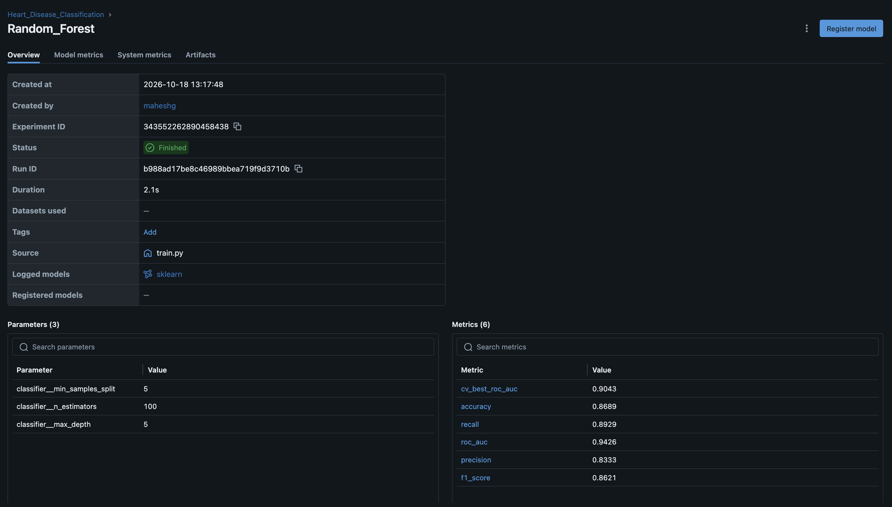
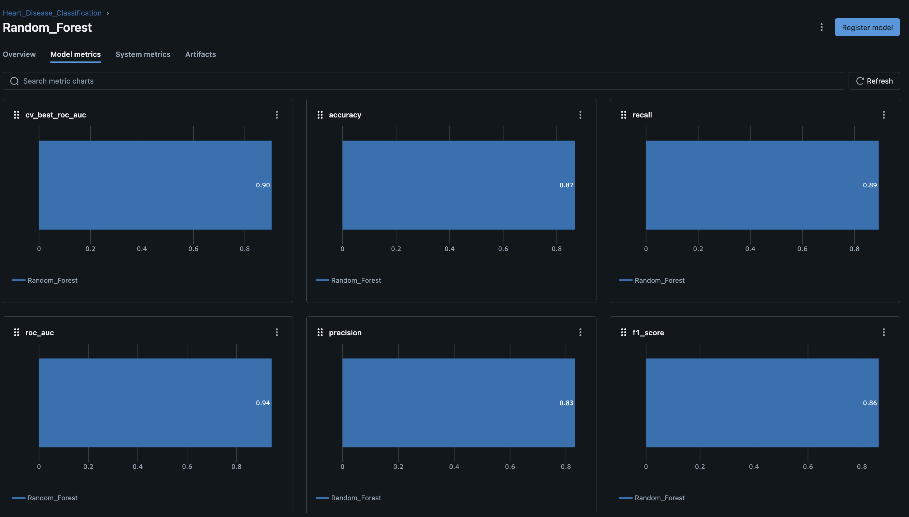
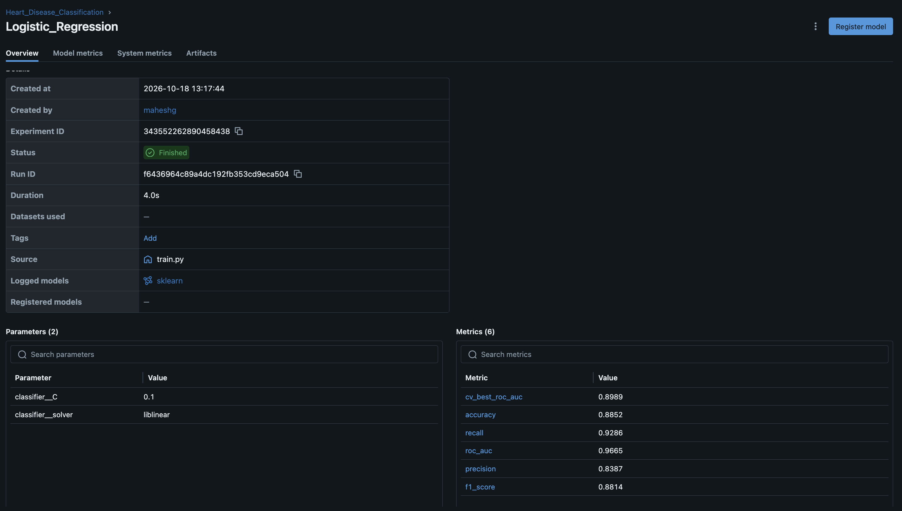
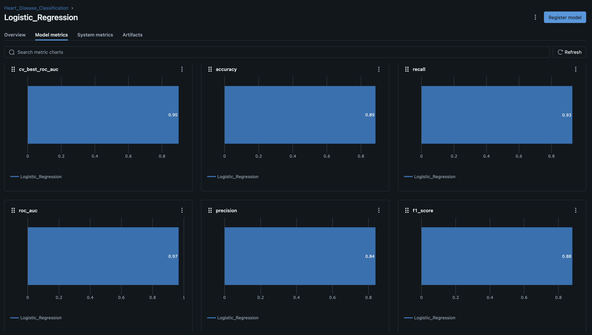


## 5. CI/CD Pipeline & Automated Testing (Task 5)

### 5.1 Unit & Integration Test Suite (`tests/`)
Three modular test files were implemented using `pytest`:

1. **`tests/test_data.py`:** Validates target binarization (`{0, 1}`), coercion of `"?"` strings to `NaN`, and verifies that `ColumnTransformer` outputs a dense matrix with zero `NaN` values.
2. **`tests/test_model.py`:** Tests metric dictionary bounds (`[0.0, 1.0]`), verifies end-to-end `Pipeline` fitting, and validates that the serialized `.pkl` model returns valid binary predictions and normalized probabilities.
3. **`tests/test_api.py`:** Uses FastAPI's `TestClient` to verify HTTP `200 OK` on `/health`, valid clinical risk predictions on `/predict`, and HTTP `422 Unprocessable Entity` rejection on malformed JSON payloads.

### 5.2 GitHub Actions Workflow (`.github/workflows/ci_cd.yml`)
On every `push` or `pull_request` to `main`/`master`, GitHub Actions executes two automated jobs:

* **Job 1 (`lint-train-and-test`):** Sets up Python 3.10, installs `requirements.txt`, runs `flake8` static analysis, executes `python -m src.eda` and `python -m src.train`, runs `pytest --cov=src`, and uploads the trained model and EDA plots as build artifacts.
* **Job 2 (`docker-build-check`):** Downloads the verified model artifact and builds `heart-disease-api:latest` to guarantee containerization integrity.


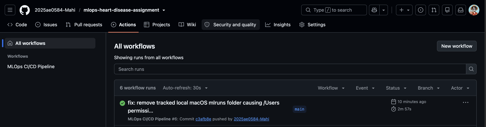
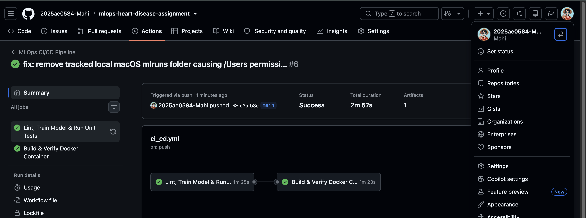
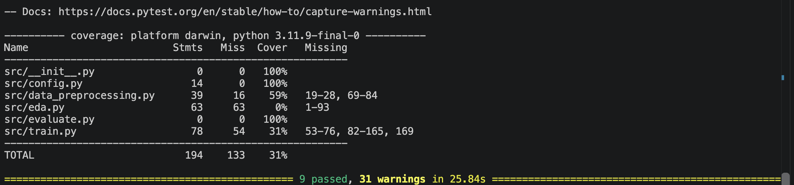

---

## 6. Containerization, Kubernetes Deployment & Monitoring (Tasks 6, 7 & 8)

### 6.1 FastAPI Service & Docker Containerization
The inference service (`app/main.py`) exposes three endpoints:

* `GET /health`: Returns service health and model load status for container/Kubernetes probes.
* `POST /predict`: Validates all 13 clinical attributes via Pydantic (`app/schemas.py`), executes pipeline inference, and returns `prediction` (`0` or `1`), `probability` (`0.0–1.0`), and clinical `risk_level` (`Low`, `Moderate`, `High`).
* `GET /metrics`: Exposes Prometheus scrape metrics.

The `Dockerfile` packages the application on `python:3.10-slim` with layer-cached dependencies and a native `curl` `HEALTHCHECK`.

### 6.2 Production Kubernetes Deployment (`deployment/k8s/`)
The application is deployed via declarative Kubernetes manifests:

* **`deployment.yaml`:** Manages **2 replicas** with `RollingUpdate` strategy (`maxUnavailable: 0`), CPU/memory resource limits (`256Mi–512Mi`), `readinessProbe` and `livenessProbe` targeting `/health`, and Prometheus pod annotations (`prometheus.io/scrape: "true"`).
* **`service.yaml`:** Exposes the deployment via a `LoadBalancer` service on port `8000` (`nodePort: 30080`).

API_Docs_LINK : [API_DOC]( http://localhost:8000/docs )

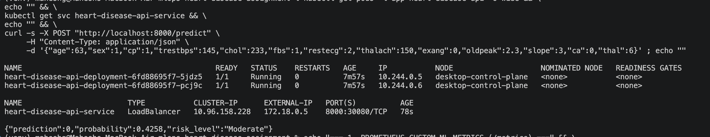

### 6.3 Logging & Prometheus Monitoring
* **Structured Request & Audit Logging:** Custom HTTP middleware logs every request's method, path, HTTP status code, and latency in milliseconds, while `/predict` logs the exact input vector, predicted probability, and assigned clinical risk tier.
* **Prometheus Metrics:** In addition to standard HTTP request rates and latencies (`prometheus-fastapi-instrumentator`), two custom ML metrics are tracked:
  1. `heart_disease_predictions_total{predicted_class, risk_level}` (Counter for prediction drift monitoring).
  2. `heart_disease_inference_latency_seconds` (Histogram tracking model scoring speed).

Metrics_Link :  [Metrics](http://localhost:8000/metrics)

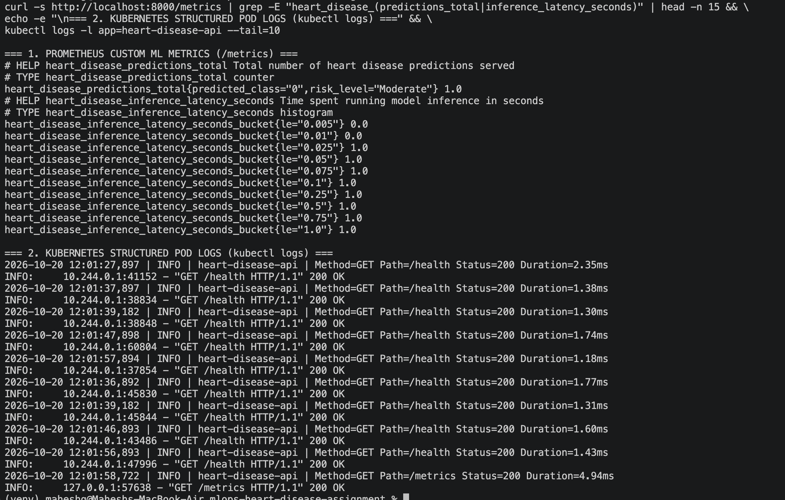

---

## 7. Setup, Installation & Local API Testing Instructions (Task 9)

To reproduce the environment, train the pipeline, and test the deployed API locally from a clean setup:

```bash
# 1. Clone repository & install pinned dependencies
git clone https://github.com/2025ae0584-Mahi/mlops-heart-disease-assignment.git
cd mlops-heart-disease-assignment
python3 -m venv venv && source venv/bin/activate
pip install -r requirements.txt

# 2. Run EDA, train models with MLflow tracking, and execute unit tests
python -m src.eda
python -m src.train
pytest tests/ -v --cov=src

# 3. Build Docker container & deploy to Kubernetes
docker build -t heart-disease-api:latest .
kubectl apply -f deployment/k8s/deployment.yaml
kubectl apply -f deployment/k8s/service.yaml
kubectl port-forward svc/heart-disease-api-service 8000:8000

# 4. Test live /predict endpoint (or open http://localhost:8000/docs)
curl -X POST "http://localhost:8000/predict" -H "Content-Type: application/json" \
  -d '{"age":63,"sex":1,"cp":1,"trestbps":145,"chol":233,"fbs":1,"restecg":2,"thalach":150,"exang":0,"oldpeak":2.3,"slope":3,"ca":0,"thal":6}'
```

---

## 8. Conclusion & Future MLOps Enhancements
This project successfully demonstrates an end-to-end, reproducible MLOps lifecycle from raw data ingestion to monitored Kubernetes serving. Future enhancements for enterprise scale include integrating **Evidently AI** for automated data drift alerts on incoming patient distributions, registering models in a centralized cloud **MLflow Model Registry** (backed by S3/PostgreSQL), and implementing **Helm charts** with Horizontal Pod Autoscalers (HPA) for dynamic traffic scaling.
 